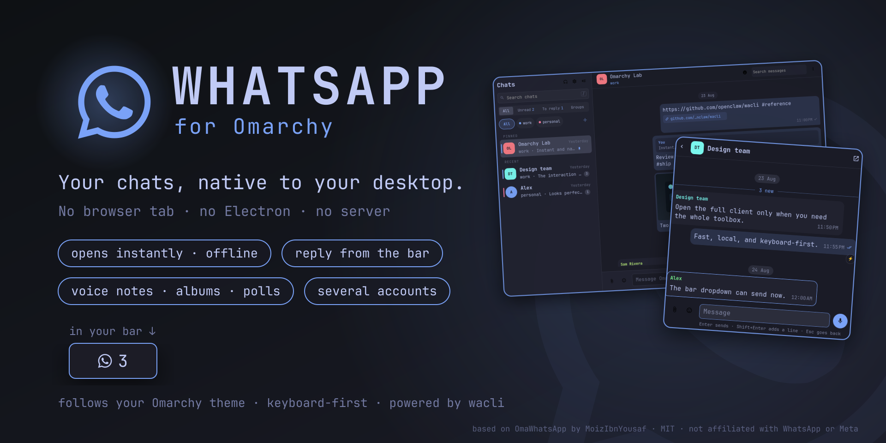
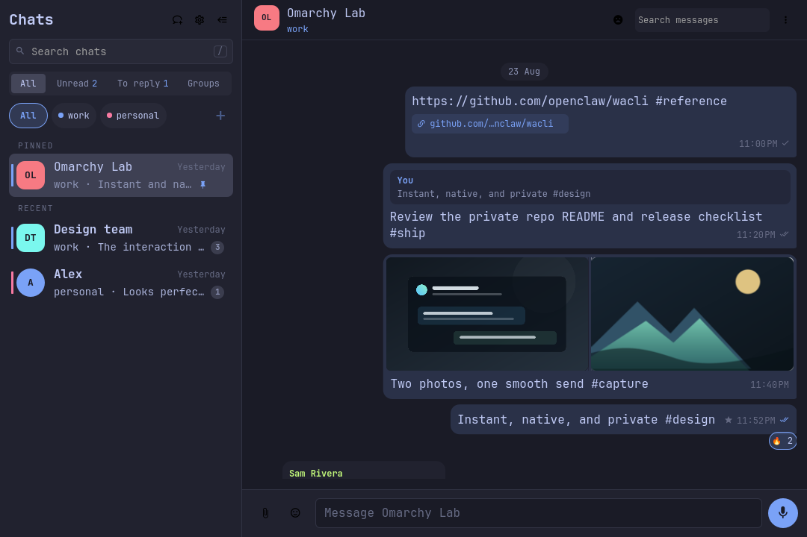
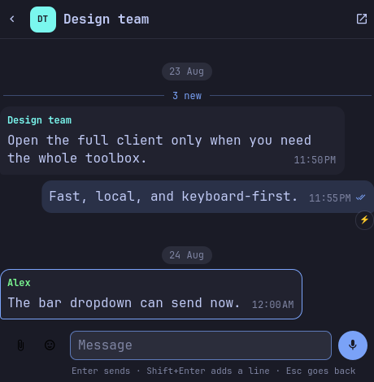
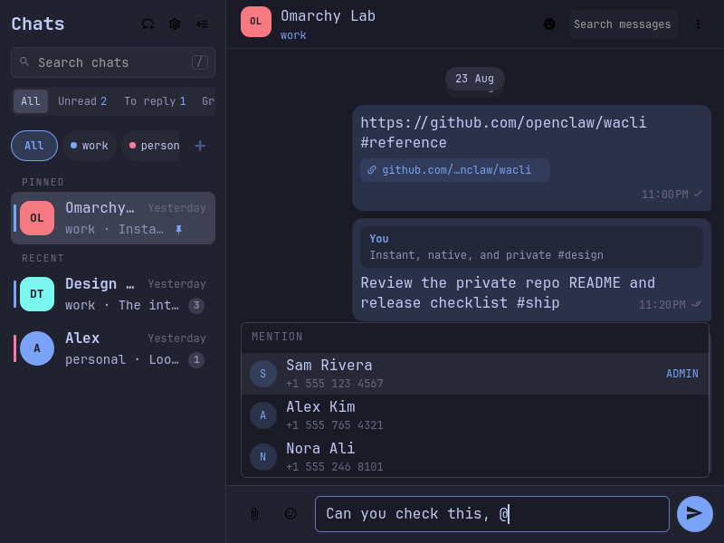
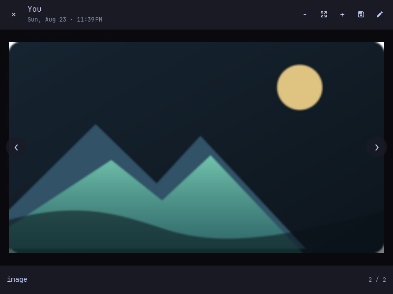
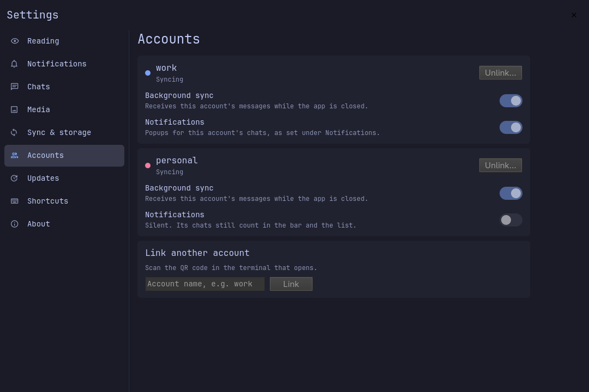
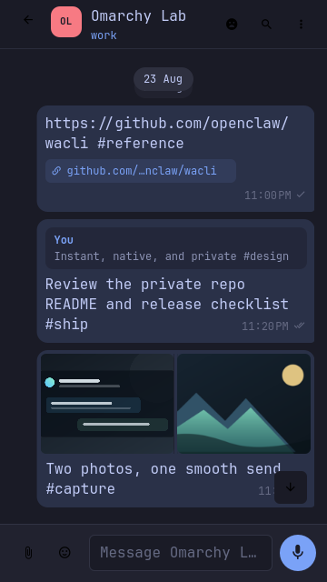

<h1 align="center">OmaWhatsApp</h1>

<p align="center"><strong>WhatsApp, native to the Omarchy shell. Not a browser tab.</strong></p>

<p align="center">
  <a href="LICENSE"></a>
  
  
</p>



A fast, local-first WhatsApp client for [Omarchy](https://omarchy.org). Your
chats live in a private local mirror kept by
[`wacli`](https://github.com/openclaw/wacli); the app renders it in Quickshell,
follows your Omarchy theme, and lives in your bar. No Electron, no browser
wrapper, and no server of its own: messages go only to WhatsApp.

## Why it feels different

**Opens instantly, works offline.** Chats and messages come from a local
SQLite mirror, so the window never waits for the network. New messages appear
the moment sync writes them, without polling. Pause sync and the whole archive
stays readable and searchable.

**Reply from the bar.** Click the bar icon for a compact client: recent chats,
the conversation, and a real composer with files, emoji and voice notes. Most
replies never need the full window.

**Everything a chat needs.** Replies, edits, reactions, polls, stickers,
albums, up to 10 files with a caption, real `@` mentions, voice notes you
review before sending, forwarding to several chats at once with a note, and
deleting many messages together.

**Feels like the phone.** The chat on screen is read, replying marks it read,
and the contact sees you typing. Desktop notifications hide private content,
open the chat on click and can be answered from the bar. Muted and archived
chats stay quiet.

**Several accounts, one list.** Link more than one number: the chat list
merges them, each account has its own color, and each can pause its sync or
silence its notifications on its own.

**Native to Omarchy.** Theme colors and fonts, keyboard-first everywhere, and
real layouts from a wide window down to 360 px. Quit with `Ctrl+Q`, and choose
whether it starts with the system.

**Your keyboard, your way.** Settings → Shortcuts lets you click a key to change it, add alternatives, resolve conflicts, or restore defaults across 37 actions. [Shortcut reference](docs/SHORTCUTS.md).

**Private by design.** No account, server or telemetry of its own. Reading a
chat sends no sender receipt by default. A separate per-account opt-in
requests receipts with wacli 0.19.0+; WhatsApp privacy settings still apply. Screenshots and tests use synthetic demo data
only. See [privacy](docs/PRIVACY.md).

**Ready for your agent.** An agent skill and an MCP server with 46 tools let
Claude Code and other agents read and act on WhatsApp for you, asking before
anything that changes WhatsApp.

## A closer look

| The full app | From the bar |
|---|---|
|  |  |

| Real group mentions | Native media viewer |
|---|---|
|  |  |

| One card per account | Down to 360 px |
|---|---|
|  |  |

Every screenshot is rendered from the repository's demo data. No real
conversation is included in this repository.

## Install

```bash
omarchy pkg add gcc pkgconf ffmpeg
omarchy pkg aur add wacli-bin
omarchy plugin add https://github.com/MoizIbnYousaf/Omarchy-Whatsapp --enable
```

The native clipboard-safe editors and isolated media worker build locally against your installed Qt on first launch (and rebuild after a Qt update). No code is downloaded during that build. Media previews use bounded child processes; FFmpeg regenerates audio/video previews without original metadata. Oversized or unsupported previews show an error, and original attachments remain available to save. See [media limits](docs/MEDIA-SECURITY.md). If the compiler or matching Qt headers are unavailable, the app keeps its editors unloaded and reports the problem.

For sending and other mutations, also build and install the privacy-enabled
wacli from pinned source as described under [Private command transport](#private-command-transport).
The first time the app opens it walks you through the rest:

1. **Set it up on this computer.** One click adds, in your home folder only,
   the background sync (a sandboxed user service), the `omawhatsapp` command,
   and, only if you turn it on, the agent skill and the MCP server. No sudo or pkexec is required.
2. **Link your phone.** Show QR code opens the code in a terminal; scan it
   from WhatsApp → Linked devices on the phone.

**Requirements.** Omarchy 4 (Quattro) and
[wacli](https://github.com/openclaw/wacli) 0.17.1 or newer (tested with
0.17.1, 0.18.3 and 0.19.0). The AUR `wacli-bin` package installs the official
release used by the read-compatibility tests. Sending and other mutations now
require the accompanying privacy-enabled 0.19.0 build; a wacli of your own at
`~/.local/bin/wacli` is used first. Choosing files to attach needs `zenity`,
which the app offers to install the first time it is missing. Everything else
comes with Omarchy.

**Add the shortcut.** Copy the `Super+Shift+W` line from
[`omarchy/bindings.lua.example`](omarchy/bindings.lua.example) into
`~/.config/hypr/bindings.lua`.

**Coming from OmaWhatsApp?** Add this app; its setup offers to turn
OmaWhatsApp off (it is not deleted, and only one of the two can run) and keeps
the same linked device and history, so nothing is linked again.

## Update and remove

**Update.** Settings → Updates checks the repository and runs
`omarchy plugin update` in a terminal, which shows the changes and asks
first; the shell then restarts to load them. From a terminal:

```bash
omarchy plugin update io.github.moizibnyousaf.omawhatsapp && omarchy restart shell
```

**Remove.** Settings → Sync & storage → **Remove from this computer** stops
background sync and removes what the setup added; then **Remove the app too**
runs `omarchy plugin remove io.github.moizibnyousaf.omawhatsapp`. Your linked device
and wacli's message store stay, so adding the app again picks up where you
left off. The app only ever replaces or removes files exactly as it wrote
them: anything you edited stays, and the app tells you which.

## wacli: official and richer builds

Local reading works with the supported official wacli releases. Sending and
other mutations require the privacy input extension described below. A few
optional extras need additional wacli features; the app detects those separately:

| Feature | Official wacli | With the additions |
|---|---|---|
| Local chats, cached media, notifications, several accounts | ✓ | ✓ |
| Sending, edits and other mutations | Privacy extension required | Privacy extension required |
| Showing the contact that you are typing | ✓ | ✓ |
| Ticks for sent, delivered and read | no tick shown | ✓ |
| A contact's online, last seen and typing | not shown | ✓ |
| Starring messages | hidden | ✓ |
| `@` on chats whose unread messages mention you | not shown | ✓ |
| Forwarding and deleting without pausing sync | pauses sync for a few seconds | ✓ |

## Let your agent use WhatsApp

When you allow it during the setup (or later in Settings), the app links an
agent skill at `~/.agents/skills/omawhatsapp`, so compatible agents can use
`$omawhatsapp` to search, summarize and, when you ask, act on your chats. For
Claude Code and other MCP clients, register the server once:

```bash
claude mcp add --scope user whatsapp -- ~/.local/bin/omawhatsapp-mcp
```

Then ask in plain words: "who wrote to me that I have not read yet, and about
what", "what attachments did Bruno send this month", "reply to Carlos that I
am on my way", "tag these five as suppliers and tell each of them we are
closed tomorrow".

Both are fail-closed. Each of wacli's 104 operations is classified as a local
read, remote read, local write, sync, WhatsApp write, destructive or
interactive action; local reads run read-only, and everything else needs your
request. Tools that change WhatsApp are marked so the client asks you first
and shows the recipient and the text. Neither ever writes to WhatsApp's
database directly, invents a recipient or retries a send that may have gone
through. Details in the
[agent gateway reference](skills/omawhatsapp/references/wacli-parity.md).

## Documentation

| Page | For |
|---|---|
| [Using the app](docs/USAGE.md) | Every feature, the settings and all keyboard shortcuts |
| [Privacy](docs/PRIVACY.md) | What is stored, where, and what never leaves your machine |
| [Architecture](docs/ARCHITECTURE.md) | How the service, the window, the helper and wacli fit together |
| [Technical notes](docs/TECHNICAL.md) | Performance budgets, refresh and sync details |
| [WhatsApp parity](docs/PARITY.md) | Which WhatsApp features exist and how each one was verified |
| [Agent gateway](skills/omawhatsapp/references/wacli-parity.md) | How each of wacli's operations is classified and guarded |
| [Testing](docs/TESTING.md) | The release gate and the screenshot rules |
| [Changelog](CHANGELOG.md) | What changed in each release |

## Quality

```bash
./scripts/test
```

The release gate runs helper, setup, agent and offscreen QML tests, a simulated `omarchy plugin add` into an empty home,
manifest validation, QML lint and shell checks. CI runs it against wacli
0.17.1, 0.18.3 and 0.19.0.

OmaWhatsApp is independent and not affiliated with WhatsApp or Meta.

## License

[MIT](LICENSE).

### Private command transport

From 0.18.1, sending, editing, captions and other mutation commands require the
OmaWhatsApp privacy-enabled **wacli 0.19.0** build. It keeps private command
arguments in a bounded stdin pipe instead of the Unix process command line.
This includes sensitive read-only searches, profile/media lookups,
presence and terminal authentication, not only writes.
This is a small maintained extension of upstream wacli, not an upstream release.
An ordinary older binary still supports direct local SQLite reads; the app refuses affected
operations with an upgrade message and never falls back to exposed arguments.

Build from the exact reviewed upstream commit and the patch bundled in this
checkout using [the source-build instructions](dependencies/README.md#build-and-install).
That is the supported installation path for the privacy extension. Do not use
release binaries or a checksum downloaded alongside them as an integrity
reference: a mutable release can replace both. The protocol check confirms
compatibility, not source provenance.

Restart the app after upgrading. No relinking, account migration or chat-store
change is required. Package-manager upgrades replacing wacli with an ordinary
upstream build will safely disable these operations until the private build is
restored. No binary is downloaded or installed automatically by the app.

Animated GIF/WebP surfaces now use a frame reader instead of Qt's recursive
movie restart path. Frames are limited to 2048 pixels on their longest edge;
source files over 64 MiB or images over 64 megapixels fail safely. The original
file is not modified. Malformed images display the existing unavailable state.

### Local output and process boundaries

Attachment saves and chat exports create private (0600) files. Without explicit
replacement permission, a concurrently created destination is preserved. Save
pickers use generic suggestions; choose the filename you want in the dialog.
Notification-click and GUI account-link targets cross process boundaries as
short-lived one-use random handles, not chat IDs or account labels.

This protects the app's automatic child-command payloads; it does not hide
existing filesystem paths, systemd unit identities, or commands explicitly
entered into a user's shell. The selected external file viewer necessarily
receives the path of the file the user asked it to open. Avoid placing private
values in manually entered process arguments or exported environment variables.
